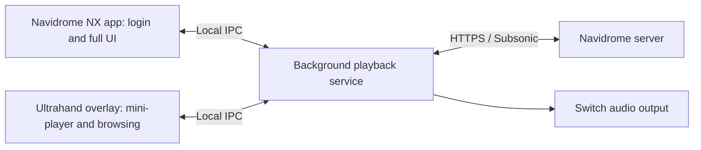

# Ultrahand mini-player feasibility

Historical design note: the full-screen app migrates from Borealis to Aurore on
`feat/aurore-ui`; framework references below describe the original baseline.

Original assessment: 2026-11-16. This document records the initial architecture
proposal. A native overlay backed by the existing sys-tune audio module is now
implemented; see [the actual build, installation, limits and validation status](ultrahand.md).
The proposed unified IPC migration below has not been implemented.

## Recommended structure

Build a native `NavidromeNX.ovl` with libultrahand, backed by an Atmosphère
playback sysmodule. Keep Borealis for the existing full-screen app.

Ultrahand supports native `.ovl` overlays alongside its scripted packages.
A native overlay fits live controls, custom artwork, and progress updates better
than an INI package. This is a design recommendation based on its documented
[overlay/package model](https://github.com/ppkantorski/Ultrahand-Overlay/wiki)
and [libultrahand UI facilities](https://github.com/ppkantorski/libultrahand).

The background-player/service plus overlay pattern already exists in
[sys-tune](https://github.com/HookedBehemoth/sys-tune). Its
[IPC interface](https://github.com/HookedBehemoth/sys-tune/blob/master/ipc/tune.h)
exposes play, pause, next, previous, queue, and current playback statistics.
That is an architectural reference, not evidence that its current backend can
stream from Navidrome: its enqueue interface accepts SD-card file paths.

## Requested overlay

- Now Playing: album thumbnail, song title, artist, elapsed/total time, progress.
- Controls: previous, play/pause, next; stop available from the player.
- Favorites: select a song and play its queue.
- Albums: browse albums, open one, select a track.
- Artists: browse artists, open their albums, select a track.
- Loading, disconnected, and artwork-unavailable states.

Use small paged lists and native overlay elements. Keep the selected row when
returning from a subpage. Closing the overlay must leave playback running.

## What this repository already provides

| Feature | Existing implementation | Required adaptation |
|---|---|---|
| Favorites | `getStarred2`, song queues | Expose paged results through IPC |
| Albums | `getAlbumList2`, `getAlbum` | Expose browsing and queue selection |
| Artists | `search3`, `getArtist` | Expose artists and their albums |
| Artwork | `getCoverArt`, bounded image validation | Decode/resize in service; return a small thumbnail |
| Progress | `PlaybackClock` | Service must own the authoritative clock |
| Transport | Previous/next/pause/stop in `App` | Move queue and audio ownership to service |
| Login | Tested config save and logout | Reload/clear the service session when account changes |
| Android remote | HTTP state and command server | Eventually control the same service |

The current `App::play()` downloads a whole MP3, up to 64 MiB, before starting
SDL_mixer. `App::shutdown()` stops playback. Therefore the NRO cannot be the
persistent audio owner for the intended in-game player. A controller overlay
while the NRO remains open is a smaller prototype, but would not establish
playback independence from the app.

The existing web remote is not a complete overlay backend: it lacks dedicated
artist/album browsing, artwork responses, and numeric elapsed/duration fields.
Local IPC avoids making the overlay depend on LAN pairing and HTTP availability.

## IPC and memory boundaries

Suggested service commands: get player state; list favorites/albums/artists;
list artist albums; list album tracks; play a selected queue; pause/resume;
previous/next/stop; get artwork; reload config; clear session.

Return numeric elapsed and duration in milliseconds, track IDs, bounded titles,
artist names, queue position, and playing/paused/buffering/error state. Browse in
small pages, for example 25 items. Version the interface before connecting both
front ends.

Start with one 128×128 RGBA thumbnail: 64 KiB. The renderer provides bitmap
functions in its [source](https://github.com/ppkantorski/libultrahand/blob/main/libtesla/include/tesla.hpp).
This is a proposed thumbnail budget, not measured total overlay memory use.
The service should fetch artwork by ID, validate dimensions and byte limits,
and supply a placeholder when unavailable. No network or image decoding should
block the overlay drawing/input thread.

Use bounded compressed/PCM buffers for service playback rather than carrying the
NRO's 64 MiB whole-track strategy into an overlay. Networking, decoding, queue,
and audio output belong in the service. The overlay should not hold a separate
copy of the Navidrome password. Logout must stop and clear the service session.

## Implementation sequence and proof

1. Prove background playback with one Navidrome track: close the UI and overlay,
   launch a game, and verify continuous audio and clean stop/recovery.
2. Add the native overlay player, numeric progress, thumbnail, and transport IPC.
3. Add Favorites → songs, Albums → tracks, and Artists → albums → tracks.
4. Connect the Borealis player and Android remote to the same service so there
   is one queue and one audio owner.
5. Add Docker targets for `.ovl` and sysmodule packaging, preserving the current
   NRO artifact target.

Before deployment, check the console's HOS, Atmosphère, Ultrahand, and overlay
loader versions. Measure overlay heap, service memory, CPU use, network stalls,
audio mixing with a game, repeated opening/closing, suspend/resume, and account
logout. These have not been tested by this feasibility assessment. Pin upstream
revisions and retain their included license notices when implementation starts.

Primary implementation revisions inspected: libultrahand
`548e491e19d791120ad3de05b4a7efea4ca00e34`; sys-tune
`24132cfa26e569011a2028790575cd474f32cf95`.
